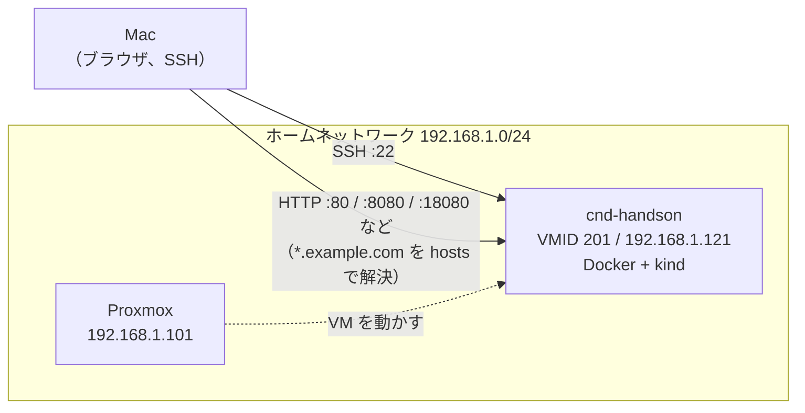

# Proxmox でのハンズオン用 VM

[chapter_setup](../README.md) は AWS の EC2 に VM を作る手順になっている。ここでは、同じ役割の VM を自宅の Proxmox（`192.168.1.101`）に作る。

## 構成



| 項目 | 値 |
|---|---|
| VMID / 名前 | `201` / `cnd-handson` |
| OS | Ubuntu 22.04 LTS（クラウドイメージ） |
| vCPU / RAM / ディスク | 4 / 16GB / 80GB（`local-lvm`） |
| CPU タイプ | `host`（ネストした仮想化が使える） |
| ネットワーク | `vmbr0`、`192.168.1.121/24`、GW / DNS `192.168.1.1` |
| ユーザー | `ubuntu`（SSH の鍵認証だけ） |
| 自動起動 | `onboot: 0`（ハンズオンをするときだけ起動する） |
| ゲストエージェント | 有効 |
| スナップショット | `clean`（`setup.sh` の直後、kind のクラスタを作る前） |

元の手順（AWS）との違い:

| 項目 | AWS | Proxmox |
|---|---|---|
| ディスク | 50GB | 80GB（全部の章をこなすとイメージが溜まるので増やした） |
| SSH 鍵 | `aws ec2 create-key-pair` で作る | Mac の公開鍵を cloud-init で渡す |
| ポートを開ける | Security Group | なし。ホームネットワークに置き、VM の NIC のファイアウォールは無効のまま |
| inotify の上限 | chapter_cluster-create で `/etc/sysctl.conf` を上書きする | `setup.sh` で `/etc/sysctl.d/90-kind-inotify.conf` に書く |
| リポジトリ | upstream の `main` | このフォークの `hands-on` ブランチ |

## ファイル

```
create-vm.sh  # VM の作成。Proxmox のシェルで実行する
setup.sh      # パッケージ、Docker、hosts、リポジトリ。VM の中で sudo で実行する（何度実行してもよい）
hosts.txt     # Mac の /etc/hosts に追記する行
```

## 構築手順

### 1. VM の作成

Mac の公開鍵とスクリプトを Proxmox に送って実行する。

```bash
scp create-vm.sh ~/.ssh/<公開鍵>.pub root@192.168.1.101:/root/
ssh root@192.168.1.101 './create-vm.sh <公開鍵>.pub; rm -f create-vm.sh <公開鍵>.pub'
```

- Ubuntu のクラウドイメージは `SHA256SUMS` で確かめてから取り込む。取り込みが終わったら（失敗したときも）消す
- `.img` の中身は qcow2。`local` ストレージの `import` は `.img` を受け付けないので、`.qcow2` の名前で保存している
- `qm create` が成功したあとで失敗したら、作りかけの VM を `qm destroy --purge` で消す。`qm create` 自体が失敗したときは消さない（VMID がほかで使われていたときに、その VM を消さないため）
- `import-from` には、`local` ストレージの content に `import` が要る（PVE 8.3 以降。足りなければ `pvesm set local --content iso,vztmpl,backup,import`）
- VMID の確認は `qm status` なので、このノードの VM しか見ない。複数ノードのクラスタでは、ほかのノードの VMID 201 を見落とす（今の Proxmox は 1 台）
- `current` のイメージを使うので、作るたびに中身が新しくなる

cloud-init が終わると、Mac から入れる。

```bash
ssh ubuntu@192.168.1.121
```

### 2. セットアップ

```bash
scp setup.sh ubuntu@192.168.1.121:/tmp/
ssh ubuntu@192.168.1.121 'sudo /tmp/setup.sh'
```

入れるもの:

- chapter_setup のパッケージ（curl、vim、git、unzip、gnupg、lsb-release、ca-certificates、dstat、jq）と `qemu-guest-agent`
- Docker CE（公式の apt リポジトリ）。`ubuntu` を `docker` グループに入れる
- inotify の上限（`/etc/sysctl.d/90-kind-inotify.conf`）
- VM の `/etc/hosts` に `127.0.0.1` の 4 行（`app`、`app-cilium`、`troubleshoot`、`cnd-web`）。cloud-init のテンプレート（`/etc/cloud/templates/hosts.debian.tmpl`）にも書く
- `~/cnd-handson`（このフォークの `hands-on` ブランチ）。すでにあれば触らない

注意:

- Proxmox の cloud-init は `manage_etc_hosts: true` を渡すので、`/etc/hosts` は起動のたびにテンプレートから作り直される。`/etc/hosts` だけに書くと、再起動で消える
- 初回起動の直後は apt のロックが取られていることがあるので、`cloud-init status --wait` で待ち、apt-get に `DPkg::Lock::Timeout=600` を付けている
- `docker` グループは、ログインし直すまで効かない。`setup.sh` を実行した SSH のセッションでは `docker` が `permission denied` になる
- kind、kubectl、helm などは入れない。chapter_cluster-create の `install-tools.sh` で入れる
- `sysctl --system` は Ubuntu 既定の設定（`promote_secondaries`）でエラーを出すので、追加したファイルだけを `sysctl -p` で反映している

### 3. スナップショット

ハンズオンを最初からやり直せるように、Proxmox のシェルでスナップショットを取る。

```bash
qm snapshot 201 clean --description "setup.sh 直後（kind 未作成）"
# 戻すとき
qm rollback 201 clean && qm start 201
```

### 4. Mac の hosts

`hosts.txt` を Mac の `/etc/hosts` に追記する。`hosts.txt` と `setup.sh` の 4 行は [chapter_setup](../README.md) の一覧を写したものなので、upstream で名前が増えたら合わせて直す。

```bash
sudo sh -c 'cat hosts.txt >> /etc/hosts'
```

ハンズオンが終わったら、追記した行を消す（`*.example.com` が VM に向いたままになる）。

## 使い方

起動と停止は Proxmox で行う。

```bash
qm start 201
qm shutdown 201
```

VM に入ったら、chapter_cluster-create から進める。

```bash
ssh ubuntu@192.168.1.121
cd ~/cnd-handson/chapter_cluster-create
```

## 動作確認

2026-11-22 の確認結果:

- `create-vm.sh` は 2 分ほど（イメージのダウンロードを含む）、`setup.sh` は 1 分ほどで終わった
- `setup.sh` を 2 回続けて実行し、2 回目も正常に終わった。`/etc/hosts` の行は増えなかった
- 再起動のあとも inotify の上限が残り、ログインし直すと `sudo` なしで `docker run hello-world` が通った
- 最初の版では、再起動で VM の `/etc/hosts` の 4 行が消えていた（cloud-init の `manage_etc_hosts`）。テンプレートにも書くように直し、再起動のあとも 4 行が残り、`getent hosts app.example.com` が `127.0.0.1` を返すことを確かめた
- Proxmox からゲストエージェント経由で VM の IP（`192.168.1.121`）が見えた。スナップショットのときに `fs-freeze` / `fs-thaw` が行われた
- chapter_cluster-create の手順（`install-tools.sh`、kind のクラスタ、Gateway API、Envoy Gateway の CRD、`helmfile sync`、Gateway、アプリ）をそのまま実行し、`cilium status` が OK になった
- VM の中と Mac（`curl --resolve app.example.com:80:192.168.1.121`）から `http://app.example.com` に接続し、200 が返った
- Mac から 8080 番（Cilium の Ingress）に接続すると、すぐに接続を拒否された（Ingress をまだ作っていないため）。タイムアウトではないので、Proxmox のファイアウォールでは止められていない
- 確認のあと VM を作り直し、`setup.sh` の直後に `clean` のスナップショットを取った（hosts を直したあとに取り直した）
